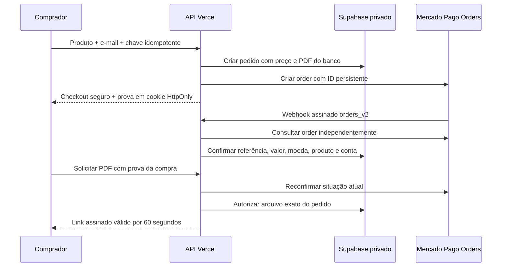

# Mercado Pago + entrega automática Kids — preparação técnica

## Estado e limites

Branch isolada `feat/mercado-pago-pdf-seguro`, baseada em development
`db6feea76128f7dca07a6a50954598c350d9b6fe`. Nenhum produto foi criado, convertido,
publicado ou atualizado nesta etapa. Nenhuma migração foi executada remotamente,
nenhum PDF foi enviado e nenhuma cobrança foi realizada. Segredos não foram
solicitados no chat ou configurados pelo agente. Os trabalhos anteriores/artifacts/
estão preservados. Commit e push ocorrerão somente nesta branch após os checks.

**Isto é preparação testada por simulação, não um checkout de produção validado.**
Não há conta Mercado Pago de teste, domínio remetente de e-mail ou sessão administrativa
acessíveis ao agente para testes reais. O backend falha de forma fechada sem configuração.

## Arquitetura



- Checkout Pro via **Orders API**, `POST /v1/orders`, usando `type=online`,
  `processing_mode=manual` e `capture_mode=automatic_async`. Não mistura o fluxo
  antigo de Preferences com o de Orders. Pix/cartão dependem da conta e do checkout.
- Preço e arquivo são obtidos no banco em transação; navegador não informa preço.
  Chave idempotente persistida com escopo vinculado a cookie seguro. A mesma UUID
  do pedido é enviada como X-Idempotency-Key ao provedor em todas as tentativas.
- Webhook HMAC-SHA256: valida cabeçalhos, ID assinado e correspondência do corpo.
  IDs alfanuméricos são normalizados conforme o manifesto de assinatura.
  Notificações atrasadas podem ser processadas, sempre com consulta atual ao provedor.
- Antes de conceder acesso: confere ID Mercado Pago, external_reference, item,
  quantidade, total, total pago, moeda BRL, país BRA, vendedor, aplicação e liquidação.
  `processed/accredited` só autoriza após webhook válido. Retorno do navegador e
  parâmetros como `status=approved` são ignorados como prova de pagamento.
- Eventos são persistidos sem dados sensíveis; versões do provedor e bloqueio de linha
  tratam repetições e eventos fora de ordem. Reembolso parcial/total, cancelamento ou
  chargeback revogam acesso; uma aprovação posterior não restaura uma revogação.
- Prova de compra de 256 bits em cookie Secure/HttpOnly/SameSite=Lax; só o hash fica
  no banco. UUID previsível ou informado pelo comprador nunca basta para baixar.
- Cada pedido fixa asset_id/product_id/hash. Não há parâmetro de arquivo que permita
  escolher outro kit. Novos links exigem nova consulta ao provedor; indisponibilidade
  do provedor bloqueia o download. Rate limits são persistentes no banco.
- PDF em bucket privado. URL assinada expira em 60 segundos, sem cache e sem URL
  permanente. Um link já emitido pode continuar válido por esse curto prazo após
  estorno; arquivo já baixado não pode ser recolhido. Novos links ficam bloqueados.
- Download com nome de arquivo e abertura inline para impressão usam o mesmo controle.
  A impressão é escolhida pelo comprador no navegador/leitor, em papel A4.
- Recuperação: e-mail registrado na compra recebe link com token aleatório em fragmento,
  validade de 10 minutos e uso único. A página remove o fragmento do endereço e exige
  clique explícito. O resgate gira a prova de acesso; download continua sujeito ao
  pagamento atual. Resposta genérica e limites impedem revelar quem tem compras.

## Mudanças propostas no Supabase — NÃO aplicadas

Migração: `supabase/migrations/20261028010000_digital_payments_PROPOSTA.sql`.
Ela bloqueia por padrão sem `lojinha.approve_digital_payments=yes` na sessão SQL.
É uma proposta para revisão; NÃO execute `supabase db push` em produção nesta etapa.

- Amplia exclusivamente a CHECK de purchase_method para incluir mercado_pago.
  Não converte dados existentes e não altera a RLS de products/categories/admins.
- digital_assets: versões imutáveis por produto, hash, bytes, páginas, atividades e
  uma versão ativa. Arquivos antigos permanecem vinculados aos pedidos antigos.
- digital_orders: snapshot confiável, preço em centavos, IDs do provedor, status,
  hash da prova, confirmação do webhook e versão da consulta.
- digital_events, digital_downloads: auditoria mínima de confirmações e acessos.
- digital_recovery: tokens somente em hash, expiração e consumo único.
- digital_rate_limits: cotas persistentes para checkout, recuperação e downloads.
- RPCs transacionais de criação idempotente, snapshots, recuperação, rate limit e
  substituição de arquivos. Somente o backend com credencial privilegiada pode chamá-las.
- Novas tabelas com RLS; administrador pode consultar relatórios, mas não conceder
  pagamento diretamente pelo navegador. Visitantes não leem pedidos, hashes ou arquivos.
- Bucket kids-pdfs-private privado, PDF até 25 MB. Administradores podem ler/enviar
  pelo JWT existente; sem UPDATE/DELETE de PDFs. Nenhuma política existente é removida.
- Se já existir purchases/orders, a proposta interrompe para analisar e reaproveitar
  a estrutura, em vez de criar duplicata. A API pública retornou PGRST205 para essas
  tabelas, mas isso não substitui inspeção administrativa do esquema antes de aplicar.
- Bucket com esse nome que já esteja público também bloqueia a migração.

## PDFs e associação

Foram encontrados **65 PDFs físicos para 63 kits lógicos**, com **31.693 atividades**.
Os 63 PDFs de referência foram novamente conferidos por hash e número de páginas.
Total das referências: 186.963.487 bytes; maior arquivo: 8.814.670 bytes.
Nenhum arquivo completo está no repositório ou em public/dist/assets.

Duas versões alternativas exigem escolha explícita:
- Bingo de Figuras: 301 páginas (300 atividades + capa), hashes diferentes.
- Jogo da Memória: 187 páginas (186 atividades + capa), hashes diferentes.
As versões avulsas e as extraídas do ZIP são mantidas intactas. O lote não escolhe
uma dessas versões sem confirmação. Nenhum PDF de referência está ausente.

Manifesto de metadados: `src/data/kidsPdfManifest.json`. Não contém PDFs ou URLs
públicas de PDF. A consulta pública atual permitiu mapear **10 IDs de kits**;
**53 IDs dependem da consulta administrativa dos rascunhos**. Não foram inventados IDs.
O total de cadastrados informado pela administradora é preservado; a limitação é de acesso.

Mapeamento privado com caminhos locais e IDs efetivamente conhecidos:
`%TEMP%\lojinha-kids-payment-private-20261028\mapeamento-privado.json`.
Não é versionado nem publicado. Pode ser completado com o JSON exportado por uma
sessão administrativa autorizada na nova tela e o script:

```powershell
python scripts/prepare-private-pdfs.py --audit "$env:TEMP\lojinha-kids-private-analysis-20261028\source-audit.json" --products "CAMINHO_DO_mapeamento-kids-admin.json" --private-output "$env:TEMP\lojinha-kids-payment-private-20261028"
```

A tela administrativa faz correspondência por slug/aliases, bloqueia ambiguidades,
calcula SHA-256 localmente e só envia arquivo correspondente. Progresso e falhas são
mostrados; relatório de falhas pode ser salvo. Após interrupção, selecione novamente
os arquivos: mesma versão ativa é pulada; upload existente sem finalização pode ser
validado e associado na retomada sem sobrescrever. Outro PDF ativo exige substituição
individual explícita, também validada em transação no banco.

## Administrativo e ativação gradual

Nova rota protegida `/admin/materiais-digitais`: produtos/IDs, PDF, situação do arquivo,
preço, método, pedidos recentes, autorização de entrega, falhas e versões.
Nova opção **Mercado Pago — PDF automático** no formulário, sem mudar o método de
nenhum cadastro. Cliente vê somente o botão do método escolhido. A área de personalizados
WhatsApp e os checkouts Hotmart continuam independentes.

O teste inicial fica restrito a `kids-animais-para-colorir`, 72 atividades, R$ 9,90.
Uma administradora pode iniciar checkout de teste desse rascunho, após associar o PDF,
sem publicar o produto nem trocar sua forma de compra. Teste administrativo exige JWT
validado e is_admin no servidor, ambiente test e conta vendedor de teste verificada.
A API consulta /users/me antes de criar a order e recusa conta real em modo test.
Também verifica IDs ORDTST e a aplicação/conta da resposta. Não se decide o ambiente
apenas pelo prefixo do Access Token.

Os demais kits permanecem na etapa de preparação/associação. Não há ativação em massa.
O guardião do piloto é intencional: ativação dos outros kits exige revisão posterior
do piloto e ampliação explícita e testada da lista permitida, nunca conversão automática.
Para vender futuramente, a administradora deverá revisar a descrição, inclusive qualquer
instrução antiga de entrega manual pelo WhatsApp, sem alteração automática de textos.

## Configuração segura e testes reais pendentes

1. Criar/selecionar aplicação Checkout Pro/Orders em Suas integrações no Mercado Pago.
   Usar contas vendedor e comprador de teste distintas e os cartões/meios de teste
   oficiais. Não informar cartões reais nem realizar cobranças reais nesta preparação.
2. Usar primeiro um Supabase de homologação, com esquema e produtos equivalentes sem
   dados pessoais de clientes. Frontend e backend devem apontar para o mesmo projeto
   nesse ambiente. Não trocar as variáveis da loja oficial ou encerrar sua sessão.
3. Revisar tabelas existentes e a proposta SQL. Aplicar só em homologação após aprovação.
   Produção exige autorização separada e nova conferência do esquema e das políticas.
4. Configurar privadamente, apenas no ambiente Preview/branch apropriada da Vercel:
   SITE_URL (origem HTTPS exata), SUPABASE_URL, SUPABASE_ANON_KEY,
   SUPABASE_SECRET_KEY (ou service_role legado, somente servidor), MP_ACCESS_TOKEN,
   MP_WEBHOOK_SECRET, MP_SELLER_ID, MP_APPLICATION_ID e PURCHASE_PROOF_SECRET
   (aleatório com pelo menos 32 bytes). Nunca usar prefixo VITE_ em segredos.
5. Recuperação usa Resend: configurar domínio remetente verificado, RESEND_API_KEY e
   PURCHASE_EMAIL_FROM. Não usar endereço fictício. Nenhum e-mail foi enviado nesta etapa.
6. Inicialmente manter PAYMENTS_ENABLED=false, PRIVATE_PDF_UPLOADS_ENABLED=false,
   MP_ENVIRONMENT=test e ALLOW_LIVE_PAYMENTS=false. Exemplo sem credenciais em
   `payment-review/server-env.example`.
7. Após autorizar envio em homologação, habilitar apenas o upload privado e associar o
   PDF do piloto. Nenhum PDF foi enviado a qualquer Supabase nesta etapa.
8. Configurar webhook HTTPS `SITE_URL/api/payments?action=webhook` para tópico orders_v2,
   segredo do ambiente de teste. Confirmar a entrega real do webhook e os contratos
   atuais da Orders API com as credenciais de teste da conta.
9. Habilitar pagamentos SOMENTE no ambiente de teste, conferir conta vendedora de teste
   e executar o roteiro aprovado/pendente/recusado/cancelado/reembolso/repetição/recuperação.
   Registrar evidências e validar disponibilidade de Pix/cartão conforme a conta.
10. Só depois desses testes solicitar aprovação de produção: migração, upload privado,
    ativação individual dos kits e, por último, live payments. Cada passo é separado.

Nunca compartilhe segredos no chat. Não há necessidade de alterar a autenticação
administrativa ou a senha. O backend usa credencial privilegiada exclusivamente no
servidor para registros transacionais e geração de links, após autorização própria
rigorosa; essa chave jamais é enviada à aplicação React. Upload usa JWT administrativo
normal, respeitando as políticas propostas do bucket privado.

## Testes e evidências

- Testes unitários e integração simulada: suite do projeto e server/payments/*.test.mjs.
- Banco: `scripts/check-digital-db-local.mjs`, PostgreSQL PGlite somente em memória.
  Valida migração, RLS, bucket privado, duplicação, valor do banco, recuperação,
  eventos, estornos, versões, ausência de alteração dos produtos e confirmação de troca.
- Navegador: `payment-review/browser-check.json` e screenshots/. Desktop 1440px e
  celular 390px. APIs inteiramente interceptadas; download/impressão usa PDF sintético
  criado em memória, nunca um PDF pago. Nenhuma cobrança/envio/e-mail real.
- Os testes reais Mercado Pago/Supabase privado/e-mail NÃO foram executados, pois
  dependem de configuração e das autorizações acima. Não declarar produção funcional.
- Auditoria de dependências: dois avisos herdados no Vitest foram corrigidos com
  atualização pontual para 4.1.12. Auditoria posterior sem vulnerabilidades conhecidas.
- Build usa guardião de arquivos: nenhum PDF/ZIP em public/dist; .gitignore bloqueia
  PDFs, ZIPs e dados privados locais. O aviso de bundle principal >500 kB é informativo.

## Fontes oficiais consultadas em 28/10/2026

- https://www.mercadopago.com.br/developers/pt/docs/checkout-pro-orders/create-order
- https://www.mercadopago.com.br/developers/pt/docs/checkout-pro-orders/notifications
- https://www.mercadopago.com.br/developers/pt/docs/checkout-pro-orders/payment-management/status/order-status
- https://www.mercadopago.com.br/developers/pt/reference/online-payments/checkout-pro-orders/overview
- https://supabase.com/docs/guides/storage/buckets/fundamentals
- https://supabase.com/docs/guides/storage/security/access-control
- https://vercel.com/docs/errors/function_response_payload_too_large
- https://pdf-lib.js.org/docs/api/classes/pdfdocument

Vercel tem limite de payload; por isso PDFs grandes não transitam como upload ou
resposta binária da função. Upload vai diretamente ao Storage privado com JWT, e a
entrega autorizada usa URL assinada de curta validade.

## Arquivos principais e preservação

- Backend: api/payments.js; server/payments/{application,security,repository,providers}.mjs
  e respectivos testes.
- Banco: proposta SQL versionada e teste local de RLS/fluxos em scripts/.
- Frontend: páginas AdminDigital, DigitalCheckout, DigitalReceipt e DigitalRecovery,
  serviços digitalPayments, lib/privatePdfs, manifesto, estilos e testes.
- Integração limitada: App (rotas lazy), AdminLayout (atalho), AdminProductForm (terceiro
  método), ProductDetail/purchase (botão exclusivo) e types.
- Dependências: pdf-lib só no backend; correção pontual do Vitest; build inclui guardião.
- Preparação: scripts/prepare-private-pdfs.py; relatórios e exemplos sem credenciais.
- AuthContext, ProtectedAdmin, cliente Supabase, alteração de senha, home/layout público,
  serviços personalizados e dados de todos os produtos permanecem preservados.

A lista completa dos arquivos, os números finais dos checks e o commit serão registrados
após a última revisão. Não haverá merge, push para development, deploy de produção,
migração remota, envio de PDFs ou habilitação de cobrança real nesta etapa.

## Resultado final da preparação

- **236 testes automatizados aprovados em 28 arquivos**.
- **33 verificações de banco/RLS somente em memória**.
- **Build aprovado**, guardião sem PDFs/ZIPs públicos.
- Navegador: desktop/celular, APIs simuladas, PDF sintético, sem erros ou violações
  axe nas novas telas verificadas. Download, abertura para impressão, pendência,
  estorno, checkout simulado e recuperação aprovados nessa simulação.
- Auditoria de dependências: **zero vulnerabilidades conhecidas** após corrigir Vitest.
- **65 PDFs físicos / 63 kits / 63 fontes validadas / zero uploads remotos**.
- **10 IDs de produtos confirmados pela consulta pública; 53 dependem do acesso
  administrativo**. Não confundir validação do arquivo com associação final ao ID.
- Bingo de Figuras e Jogo da Memória exigem escolha entre versões com hashes distintos.
- **Zero cobranças, zero e-mails reais, zero migrações remotas, zero conversões de
  compra e zero publicações de produtos**.
- Arquivos completos em `arquivos-alterados.txt`; resultados em `final-checks.json`.
- Falta configurar ambiente isolado, conta vendedor/comprador de teste, webhook,
  segredo de prova, bucket privado e remetente de e-mail verificado. Remetente é
  uma configuração real pendente; não foi inventado endereço nem usado Gmail como
  domínio remetente não verificado. Testes reais ainda precisam ser executados.
- Commit autorizado: `feat: preparar Mercado Pago e entrega automatica Kids`.
  O identificador e o resultado do push da branch serão informados na entrega.

A retomada do lote é por arquivo: arquivos completos já verificados são pulados;
se a rede cair durante um arquivo, ele pode precisar ser reenviado, mas não será
sobrescrito ou duplicado. O relatório de falhas pode ser salvo pela administradora.
Não há promessa de transferência parcial de bytes retomável dentro de um PDF.

A opção **Conferir somente cadastros e IDs** usa a autenticação administrativa
existente e a leitura paginada já validada do importador. Permite exportar os 63
IDs antes de aplicar a migração ou configurar chaves de pagamento. Esse modo não
consulta tabelas de pedidos nem afirma que PDFs privados estejam associados.
